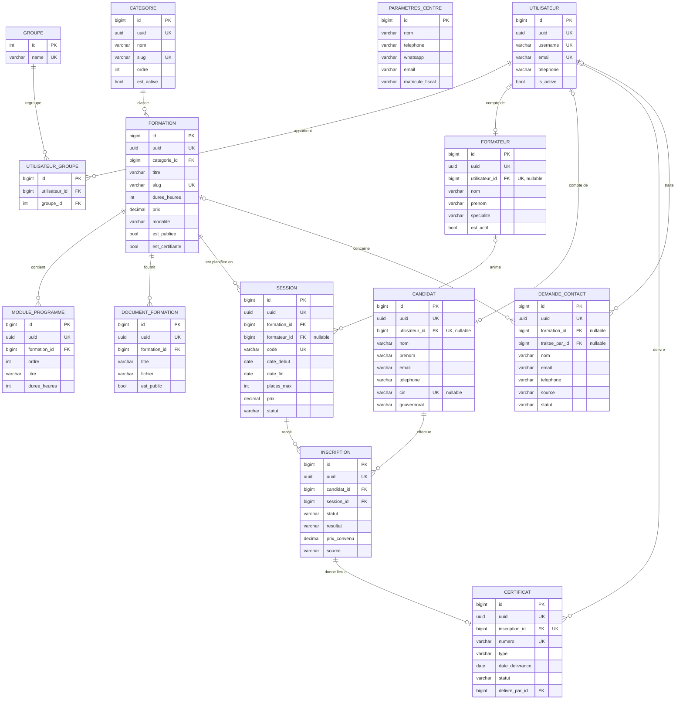

# Architecture — Plateforme de gestion d'un centre de formation

Document de référence validé le 15/10/2026. Toute évolution de l'architecture doit être reportée ici.

## Principes

- **Un seul centre de formation** (pas de multi-centres).
- **Évolution par niveaux**, sans refonte de structure :
  - Niveau 1 — Site vitrine : Accueil, Formations, À propos, Contact.
  - Niveau 2 — Site commercial : Formations, Sessions, Inscription, WhatsApp.
  - Niveau 3 — Plateforme de formation : espaces Candidat, Formateur, Admin, Certificats.
- **Identifiants** : `id` numérique (`BigAutoField`) comme clé primaire interne, champ `uuid` comme identifiant public.
  L'`id` n'est jamais exposé hors de l'administration Django.
- **Pas de suppression des données métier** : `on_delete=PROTECT` et indicateurs d'archivage
  (`est_active`, statut « annulée ») plutôt que suppression.
- **Montants** en dinars tunisiens : `DecimalField(max_digits=10, decimal_places=3)`.

## Décisions validées

| # | Décision |
|---|---|
| 1 | 7 applications : `core`, `accounts`, `catalog`, `commercial`, `trainers`, `enrollments`, `certificates`. |
| 2 | Modèle utilisateur personnalisé `accounts.Utilisateur`, connexion par email. |
| 3 | Noms d'applications en anglais ; modèles et champs en français sans accents (`Formation`, `date_debut`, `est_publiee`) ; libellés (`verbose_name`) en français. |
| 4 | `Formateur` et `Candidat` existent sans compte, avec un lien facultatif `OneToOne` vers `Utilisateur`. |
| 5 | URL publiques du catalogue par `slug` (référencement) ; espaces privés et back-office par `uuid`. |
| 6 | Candidats : CIN unique si renseigné, téléphone obligatoire, email facultatif ; rapprochement par téléphone ou email lors d'une pré-inscription. |
| 7 | Données métier protégées par `PROTECT` et archivage, jamais supprimées. |

## Applications

| Application | Rôle | Niveau |
|---|---|---|
| `core` | Code commun, paramètres du centre, pages vitrine | 1 |
| `accounts` | Utilisateurs, rôles, permissions | 1 |
| `catalog` | Catégories, formations, programmes, documents | 1 |
| `commercial` | Demandes de contact, prospects (plus tard : devis, paiements) | 1 |
| `trainers` | Formateurs | 2 |
| `enrollments` | Sessions, candidats, inscriptions (plus tard : présences) | 2 |
| `certificates` | Certificats et vérification publique | 3 |
| `espaces` | Espaces candidat et formateur, téléchargement protégé des documents (sans modèle) | 3 |

Pourquoi ce découpage :

- `core` regroupe ce qui n'appartient à aucun métier (modèle de base, paramètres du centre, pages vitrine).
- Les sessions et inscriptions sont dans `enrollments` et non dans `commercial` : le nom `sessions` est déjà pris
  par `django.contrib.sessions`, et au niveau 3 elles porteront des données pédagogiques (présences, évaluations).
  `commercial` garde ce qui précède l'inscription.
- `trainers` est séparé de `accounts` car un formateur peut exister sans compte (affichage sur le site).

### `core`

- **Modèles** : `ModeleDeBase` (abstrait : `uuid`, `date_creation`, `date_modification`) ;
  `ParametresCentre` (ligne unique : nom, adresse, téléphone, WhatsApp, email, logo, réseaux sociaux, matricule fiscal).
- **Permissions** : pages vitrine publiques ; paramètres modifiables par l'Administrateur.
- **Contraintes** : `ParametresCentre` limité à une ligne (`CHECK id = 1`).

### `accounts`

- **Modèle** : `Utilisateur` (hérite de `AbstractUser`) : `uuid`, `email` unique (identifiant de connexion), `telephone`.
- **Rôles** : groupes Django, seule source de vérité : Administrateur, Gestionnaire, Formateur, Candidat
  (créés par migration de données).
- **Contraintes** : `email` unique, `uuid` unique.

### `catalog`

- **Modèles** :
  - `Categorie` : nom, slug, description, ordre, est_active.
  - `Formation` : categorie, titre, slug, resume, description, objectifs, public_vise, prerequis, duree_heures,
    prix, niveau, modalite (présentiel / à distance / hybride), image, est_publiee, est_certifiante.
  - `ModuleProgramme` : formation, ordre, titre, contenu, duree_heures.
  - `DocumentFormation` : formation, titre, fichier, est_public.
- **Permissions** : formations publiées visibles par tous ; gestion par Administrateur et Gestionnaire ;
  documents non publics réservés aux inscrits (niveau 3).
- **Contraintes** : `slug` unique ; `Categorie → Formation` en `PROTECT` ; `UNIQUE(formation, ordre)` ;
  `CHECK prix >= 0`, `CHECK duree_heures > 0`.

### `commercial`

- **Modèle** : `DemandeContact` : nom, email, telephone, message, formation (nullable), source
  (formulaire / WhatsApp / téléphone), statut (nouvelle / en cours / traitée), traitee_par, notes.
- **Relations** : `Formation` et `Utilisateur` en `SET_NULL`.
- **Permissions** : création publique ; consultation et traitement par le Gestionnaire.
- **Contraintes** : `CHECK` email ou téléphone renseigné ; index `(statut, date_creation)`.
- **WhatsApp** : pas de modèle ; lien `wa.me` prérempli avec le numéro de `ParametresCentre`.
- **Page Contact** (`/contact/`, route `commercial:contact`) : servie par `commercial` car elle enregistre une
  `DemandeContact` (`core` ne dépend d'aucune application métier). `core` fournit le fragment
  `core/_coordonnees.html`. Préremplissage depuis une fiche formation : `/contact/?formation=<slug>`.
- **Anti-spam** : champ piège `site_web` hors écran ; s'il est rempli, rien n'est enregistré mais le visiteur
  reçoit la réponse habituelle.
- **Traitement** : le contenu d'une demande reçue est en lecture seule dans l'administration ; seuls `statut`,
  `traitee_par` (renseigné automatiquement) et `notes` sont modifiables.

### `trainers`

- **Modèle** : `Formateur` : nom, prenom, email, telephone, specialite, biographie, photo, cv, est_actif,
  est_visible_site, utilisateur (`OneToOne`, nullable).
- **Permissions** : gestion par Administrateur et Gestionnaire ; un formateur ne voit que ses sessions (niveau 3).
- **Contraintes** : `utilisateur` unique ; désactivation plutôt que suppression ;
  `email` unique mais facultatif (vide stocké `NULL`, en minuscules) ;
  `CHECK` : un formateur inactif n'est jamais visible sur le site.
- **Règles** : rattacher un compte donne le rôle Formateur (jamais retiré automatiquement) ; le rattachement
  n'est possible que pour qui peut consulter les comptes. Le CV est une donnée personnelle, jamais affichée.

### Page d'accueil

- Gabarit `core/accueil.html` composé de balises fournies par chaque application :
  `catalogue_public` (domaines, formations à la une, nombre de formations), `sessions_publiques`
  (prochaines sessions, sessions ouvertes, stagiaires formés), `formateurs_publics` (équipe, nombre).
  `core` n'importe aucun code de ces applications.
- Administrable : slogan, présentation, coordonnées, réseaux (`ParametresCentre`),
  formations mises en avant (`Formation.est_a_la_une` ; à défaut, les dernières publiées).
- **Emplacements photo** (`core.EmplacementPhoto`) : un emplacement par endroit précis d'une page, identifié par une
  `cle` fixe utilisée par les gabarits (`photos.accueil_bandeau`…). Créés par migration (`core.0006`) :
  `accueil_bandeau`, `accueil_presentation`, `accueil_etapes`, `accueil_appel_action`, `a_propos_principale`.
  Dans l'administration : ni ajout ni suppression (même superutilisateur), seule la photo et sa description changent ;
  réservé à l'Administrateur. Toute photo doit être décrite (`texte_alternatif`, contrainte `CHECK`).
  À l'envoi (`core/images.py`) : 10 Mo maximum, orientation du téléphone appliquée, métadonnées supprimées,
  redimensionnement à `largeur_max`, conversion WebP ; l'ancien fichier est supprimé après remplacement.
  Sans photo, chaque section garde son fond par défaut. Pour ajouter un emplacement : nouvelle migration + gabarit.
  (Remplace l'ancien champ `ParametresCentre.image_accueil`, retiré en `core.0005`.)
- Chiffres clés calculés depuis la base ; un chiffre nul n'est pas affiché (jamais de valeur inventée).
- Style : bleu marine `#00205B`, jaune `#F7C800`, polices Poppins / Open Sans ; animations sans bibliothèque
  externe (`static/js/site.js`), désactivées si le visiteur préfère réduire les animations.
- Textes originaux : les sites de référence n'ont inspiré que la structure, la palette et les effets.
- Contenus administrables dans `core` : `Temoignage` (publication impossible sans `consentement_obtenu`,
  contrainte `CHECK` ; note de 1 à 5), `Partenaire` (logo obligatoire, nom unique), `QuestionFrequente`
  (question unique). Chaque section de l'accueil est masquée s'il n'y a rien de publié.
  Page `/faq/` (toutes les questions) ; l'accueil affiche les 5 premières.
- Droits : Administrateur — tous les droits sur ces contenus et modification des paramètres du centre ;
  Gestionnaire — consultation, ajout et modification des contenus, consultation seule des paramètres.

### Outils communs de `core`

- `core.validators.valider_telephone` : format de téléphone commun à toutes les applications.
- `core.fichiers.CheminAleatoire(dossier)` : `upload_to` donnant un nom aléatoire aux fichiers envoyés.
- `core.validators.normaliser_telephone` : forme unique d'un numéro (comparaison, recherche).
- `core.forms.FormulairePublicMixin` + gabarit `core/_champs_formulaire.html` : champ piège anti-spam
  `site_web` et classes Bootstrap pour tous les formulaires publics.
- `ParametresCentre.lien_whatsapp_avec_message(texte)` : lien WhatsApp prérempli.
- `core.champs.ImageCompresseeField` : champ image à utiliser pour **toute** image du projet (un test le vérifie).
  À l'enregistrement d'une nouvelle image : 10 Mo maximum, orientation appliquée, métadonnées supprimées,
  réduction à `largeur_max` (ou `champ_largeur`), conversion WebP, transparence conservée.
  Largeurs : formation 1200, formateur 400, témoignage 200, logo partenaire 400, logo du centre 512,
  emplacement photo selon l'emplacement.
- `core.champs.SuppressionFichiersRemplacesMixin` : à placer en premier parent des modèles ayant de tels champs ;
  supprime l'ancien fichier après remplacement ou retrait (après validation de la transaction uniquement).

### `enrollments`

- **Modèles** :
  - `Session` : formation, formateur (nullable), code, date_debut, date_fin, horaires, lieu, modalite,
    places_max, prix, statut (planifiée / ouverte / en cours / terminée / annulée), est_publiee.
  - `Candidat` : nom, prenom, email, telephone, cin, date_naissance, gouvernorat, niveau_etudes, profession,
    utilisateur (`OneToOne`, nullable).
  - `Inscription` : candidat, session, statut (en attente / confirmée / annulée / terminée),
    resultat (vide / réussi / échoué), prix_convenu, source (site / WhatsApp / téléphone / sur place),
    date_confirmation.
- **Permissions** : pré-inscription publique (statut « en attente ») ; validation par le Gestionnaire
  (`valider_inscription`) ; au niveau 3, formateur limité à ses sessions, candidat à ses inscriptions.
- **Services** (`enrollments/services.py`) : seul point d'entrée pour créer une inscription ou changer son statut
  (`inscrire`, `confirmer`, `annuler`, `terminer`, `verifier_inscription_possible`). Dans l'administration,
  statut, résultat, prix et source sont en lecture seule après création ; les statuts changent par des actions.
- **Places** : seules les inscriptions confirmées ou terminées occupent une place ; les inscriptions en attente
  forment une liste d'attente. La place est vérifiée à la confirmation, sous verrou de la session
  (`select_for_update`), ce qui empêche d'attribuer deux fois la dernière place (test de concurrence).
- **Code de session** généré si vide : `<SLUG-FORMATION>-<AAAA-MM>`, suffixé `-2`, `-3`… si besoin.
- **Formateur** : seul un formateur actif peut être affecté ; un formateur désactivé après affectation reste accepté.
- **Gouvernorats** : `core.constantes.Gouvernorat` (24 gouvernorats).
- **Pages publiques** : `/sessions/` (sessions visibles), `/sessions/<uuid>/inscription/` (pré-inscription),
  `/sessions/<uuid>/inscription/merci/`. Visibilité (`Session.objects.visibles()`) : session publiée, statut
  « ouverte », formation publiée et catégorie active ; sinon 404.
- **Fiche formation** : les sessions sont affichées par la balise ``
  (bibliothèque `sessions_publiques` d'`enrollments`) ; `catalog` n'importe aucun code d'`enrollments`.
- **Pré-inscription** (`services.pre_inscrire`) : candidat retrouvé par CIN, puis téléphone normalisé, puis email ;
  la fiche d'un candidat existant n'est jamais modifiée par une saisie publique (différences reportées dans les
  notes de l'inscription) ; si déjà inscrit, rien n'est modifié et la réponse est identique (on ne révèle pas
  qui est inscrit) ; transaction unique (aucun candidat créé si l'inscription est refusée).
- **Téléphone des candidats** stocké normalisé (`core.validators.normaliser_telephone`) : `98123456`,
  ou `+XXX…` pour un numéro étranger.
- **Demande de contact → fiche candidat** (`services.candidat_depuis_demande`, action d'administration
  « Créer la fiche candidat » sur les demandes de contact) : candidat existant retrouvé par téléphone puis email
  (fiche jamais modifiée, différences reportées dans les notes internes de la demande) ; sinon fiche créée
  (premier mot du nom = prénom, à vérifier) ; refus si la demande n'a pas de téléphone ou un nom d'un seul mot.
  La demande passe de « Nouvelle » à « En cours ». L'action est ajoutée par `enrollments/admin.py`, qui
  ré-enregistre l'administration de `DemandeContact` : `commercial` ne connaît pas les candidats.
  Droits requis : modifier les demandes et ajouter un candidat.

### Niveau 3 — comptes et espaces personnels

- **Création des comptes par invitation** (`accounts/invitations.py`) : action d'administration
  « Créer ou renouveler l'accès » sur un candidat ou un formateur actif. Le compte est créé (sans mot de passe),
  reçoit le rôle et est rattaché à la fiche ; un **lien d'activation personnel, à usage unique, valable 7 jours**
  est affiché, à copier ou à envoyer par WhatsApp. Pas d'inscription libre : seules les personnes connues du centre
  ont un compte. Email obligatoire sur la fiche (identifiant de connexion).
- **Jetons** (`accounts/jetons.py`) : même mécanisme que « mot de passe oublié », avec un sel et une durée propres ;
  les liens contiennent l'**uuid** du compte (jamais l'id numérique).
- **Connexion** par email (`/compte/connexion/`), déconnexion en POST uniquement, mot de passe oublié par email
  (lien valable 24 h ; même réponse que l'email existe ou non). Blocage 15 min après 5 échecs (par IP et par email).
- **Accès à un espace** = rôle (groupe) **et** fiche rattachée ; un formateur désactivé perd l'accès.
  `/espace/` dirige chacun vers son espace (personnel du centre : administration).
- **Espace candidat** (`/espace/candidat/`) : ses inscriptions (statut, prix convenu, résultat), ses documents
  (formations où il est confirmé ou a terminé), emplacement « Mes certificats ». Il modifie son téléphone et son
  email (qui est aussi son email de connexion) ; nom et CIN restent gérés par le centre.
- **Espace formateur** (`/espace/formateur/`) : ses sessions (en cours, à venir, passées), les inscrits confirmés
  d'une session avec **nom, prénom, téléphone et email uniquement** (jamais CIN, prix, notes internes) ;
  la session d'un collègue renvoie 404.
- **Documents de formation en stockage privé** (`core.fichiers.StockagePrive`, dossier `FICHIERS_PRIVES_ROOT`,
  hors de `media/`) : servis uniquement par `/espace/fichiers/<chemin>` après vérification
  (`espaces/acces.peut_telecharger`) : document public d'une formation visible → tous ; personnel avec
  `view_documentformation` ; candidat confirmé ou ayant terminé ; formateur d'une session non annulée.
  Sans droit : 404.

### `certificates`

- **Modèle** : `Certificat` : inscription (`OneToOne`, PROTECT), numero (`CERT-AAAA-NNNNN`, unique), type
  (attestation de participation / certificat de réussite), statut (valide / annulé), date_delivrance, delivre_par,
  motif_annulation, date_annulation, et le **contenu imprimé recopié à la délivrance** : titulaire, formation_titre,
  duree_heures, date_debut, date_fin, signataire_nom, signataire_fonction. Le document ne change donc pas si la
  fiche du candidat, la formation ou le signataire changent ensuite (correction : action « Mettre à jour »).
- **Pas de fichier stocké** : le PDF (reportlab, A4 paysage, QR code vers la page de vérification) est produit
  à chaque téléchargement à partir de ce contenu. Écart avec le plan initial (champ `fichier`) : aucun fichier
  à synchroniser ni à protéger. Seule l'image de signature est lue au moment du téléchargement.
- **Services** (`certificates/services.py`) : `delivrer` (inscription terminée ; réussi → certificat de réussite,
  échoué → attestation de participation ; un certificat annulé est remis en vigueur avec le même numéro),
  `mettre_a_jour`, `annuler` (motif obligatoire, certificat conservé). Numéro suivant lu sous verrou
  (`select_for_update`) et nouvel essai en cas de conflit d'unicité.
- **Délivrance manuelle** : action « Délivrer le certificat / l'attestation » sur les inscriptions, ajoutée par
  `certificates/admin.py` qui ré-enregistre l'administration des inscriptions (`enrollments` ne connaît pas les
  certificats). Colonne « certificat » dans la liste des inscriptions.
- **Administration des certificats** : consultation seule pour tous (même superutilisateur) : ni ajout, ni
  modification, ni suppression ; actions « Mettre à jour » (`delivrer_certificat`) et « Annuler » (page de
  confirmation avec motif, `annuler_certificat`) ; téléchargement du PDF (`view_certificat`).
- **Droits** : Administrateur : consulter, délivrer, annuler ; Gestionnaire : consulter, délivrer.
- **Vérification publique** : `/certificats/verifier/<uuid>/` (adresse du QR code), `noindex`, `no-store` ;
  numéro, titulaire, formation, durée, dates, type, statut. Jamais CIN, coordonnées, prix ni motif d'annulation.
  Pas de recherche par numéro (les numéros sont séquentiels, donc devinables).
- **Espace candidat** : « Mes certificats » liste les certificats **valides** ; PDF par
  `/espace/candidat/certificats/<uuid>/pdf/`, réservé au titulaire (sinon 404).
- **Signataire** (`ParametresCentre`) : nom, fonction et image « signature et cachet » en **stockage privé**
  (jamais servie par une adresse publique), modifiables par l'Administrateur seulement.

## Diagramme ERD



Les tables internes de Django (`auth_permission`, `django_session`, `django_admin_log`…) ne sont pas représentées.

## Règles d'intégrité

### Inscriptions aux sessions

| Règle | Mécanisme |
|---|---|
| Un candidat ne s'inscrit qu'une fois à une session | `UniqueConstraint(candidat, session)` |
| Réinscription après annulation | Réactivation de l'inscription existante (changement de statut), jamais de doublon |
| Nombre d'inscrits ≤ `places_max` | Contrôle transactionnel avec verrouillage de la session (`select_for_update`) |
| Inscription seulement sur une session « ouverte » | Validation formulaire et service métier |
| `date_fin >= date_debut`, `places_max > 0`, `prix >= 0` | `CheckConstraint` (appliqués par MariaDB 11.4) |
| Session avec inscrits non supprimable | `on_delete=PROTECT` ; annulation par statut |
| Prix figé à l'inscription | `prix_convenu` copié au moment de l'inscription |

**Limite MariaDB (fuseaux horaires)** : tant que les tables de fuseaux horaires de MariaDB ne sont pas chargées,
les regroupements par date avec `USE_TZ=True` (`date_hierarchy`, `__date`, `TruncDate`…) échouent. Ne pas les utiliser
avant d'avoir chargé ces tables avec `mariadb-tzinfo-to-sql`.

**Limite MariaDB** : les contraintes uniques conditionnelles (`UniqueConstraint(..., condition=...)`) ne sont pas
prises en charge et sont ignorées par Django (avertissement `models.W036`). Le projet n'en utilise pas.

### Certificats

| Règle | Mécanisme |
|---|---|
| Un certificat par inscription | `OneToOneField` vers `Inscription` |
| Un certificat par candidat et par session | Conséquence de `UNIQUE(candidat, session)` + `OneToOne` |
| Numéro unique (`CERT-AAAA-NNNNN`) | `UNIQUE(numero)` ; nouvel essai en cas de conflit |
| Délivrance si inscription « terminée » (et « réussie » pour un certificat de réussite) | Validation dans le service métier |
| Correction ou annulation | Mise à jour du même certificat (contenu recopié ou statut), jamais de doublon |
| Certificat annulé : motif et date obligatoires | `CHECK (statut='valide' OR (motif<>'' AND date_annulation IS NOT NULL))` |
| Type et statut parmi les valeurs prévues ; dates cohérentes | `CHECK` en base |
| Inscription certifiée non supprimable | `PROTECT` |

## Ordre de création

```
1. core          → modèle de base, paramètres, pages vitrine
2. accounts      → Utilisateur personnalisé
3. catalog       → dépend de core
4. commercial    → dépend de catalog, accounts          ══ Niveau 1
5. trainers      → dépend de core, accounts
6. enrollments   → dépend de catalog, trainers, commercial, accounts ══ Niveau 2
7. certificates  → dépend de enrollments, core           ══ Niveau 3
8. espaces       → dépend de toutes les applications (sommet, aucune n'en dépend)
```

Les dépendances vont dans un seul sens ; aucune application n'importe une application de rang supérieur.
